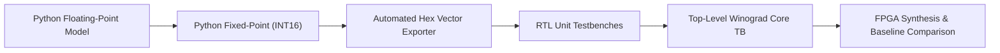
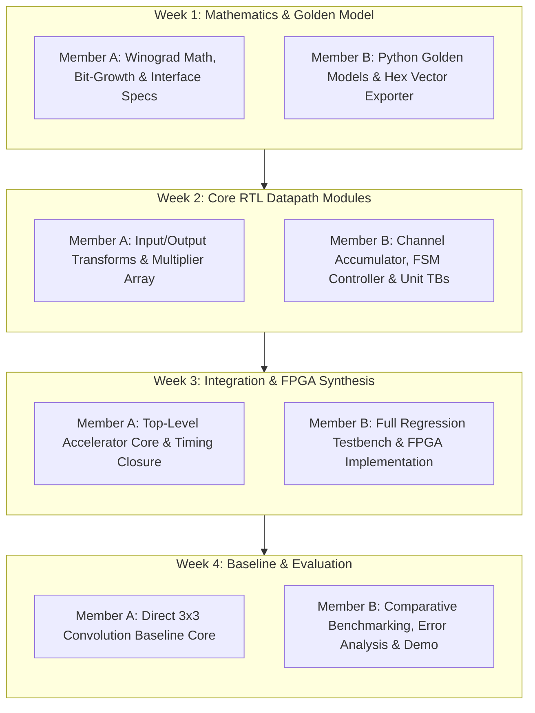

# Design and FPGA Implementation of a Winograd Convolution Accelerator for CNN Inference

[](https://opensource.org/licenses/MIT)
[](#fpga-synthesis--implementation)
[-green.svg)](#mathematical-background)

A proof-of-concept FPGA accelerator implementing **Winograd minimal filtering algorithm $F(2 \times 2, 3 \times 3)$** for 2D $3 \times 3$ stride-1 CNN convolution in fixed-point arithmetic (INT16). The design is rigorously evaluated against a fair direct-convolution baseline on the same FPGA target and precision.

---

## 1. Project Overview & Scope

### 1.1 Goal
Design, verify, synthesize, and benchmark a fixed-point FPGA accelerator core implementing Winograd $F(2 \times 2, 3 \times 3)$ for CNN inference. The accelerator is benchmarked directly against a conventional direct-convolution hardware baseline to quantify algorithmic speedup vs. hardware transform overhead.

### 1.2 Fixed Project Scope
| Item | Choice / Specification |
| :--- | :--- |
| **Algorithm** | Winograd $F(2 \times 2, 3 \times 3)$ minimal filtering algorithm |
| **CNN Operation** | 2D $3 \times 3$ Convolution, Stride 1, Valid padding / Tile-based |
| **Operational Mode** | Inference only |
| **Arithmetic Format** | Fixed-point, INT16 (Q1.15 or custom signed INT16) |
| **Weight Transform** | Offline pre-computed in Python ($U = G g G^T$), stored in 4x4 format |
| **RTL Language** | SystemVerilog (IEEE 1800-2012/2017) |
| **FPGA Flow** | AMD Xilinx Vivado / Intel Quartus Prime |
| **Reference Model** | Python 3 (NumPy / PyTorch) |
| **Baseline Architecture** | Direct $3 \times 3$ convolution accelerator (same precision & target) |
| **Primary Outputs** | Correctness, LUT / FF / DSP / BRAM utilization, $F_{\max}$, cycles/tile, GOPS |

---

## 2. Core Technical Target & Mathematics

### 2.1 The Winograd Minimal Filtering Equation
For a $2 \times 2$ output tile and a $3 \times 3$ filter kernel, Winograd's algorithm requires a $4 \times 4$ input feature map tile:

$$Y = A^T \left[ \left( G g G^T \right) \odot \left( B^T d B \right) \right] A$$

Where:
- $d$: $4 \times 4$ input feature tile
- $g$: $3 \times 3$ convolution kernel
- $U = G g G^T$: $4 \times 4$ transformed weights (pre-computed offline)
- $V = B^T d B$: $4 \times 4$ transformed input tile
- $M = U \odot V$: $4 \times 4$ element-wise multiplication
- $Y$: $2 \times 2$ final output convolution tile

### 2.2 Standard Transformation Matrices
$$
B^T = \begin{bmatrix}
 1 &  0 & -1 &  0 \\
 0 &  1 &  1 &  0 \\
 0 & -1 &  1 &  0 \\
 0 &  1 &  0 & -1
\end{bmatrix}, \quad
G = \begin{bmatrix}
 1 &  0 &  0 \\
 1/2 & 1/2 & 1/2 \\
 1/2 & -1/2 & 1/2 \\
 0 &  0 &  1
\end{bmatrix}, \quad
A^T = \begin{bmatrix}
 1 &  1 &  1 &  0 \\
 0 &  1 & -1 & -1
\end{bmatrix}
$$

### 2.3 Arithmetic Motivation
- **Direct 3x3 Convolution**: Producing a $2 \times 2$ output requires $2 \times 2 \times 3 \times 3 = \mathbf{36}$ multiplications.
- **Winograd $F(2 \times 2, 3 \times 3)$**: Produces a $2 \times 2$ output using only $4 \times 4 = \mathbf{16}$ multiplications.
- **Algorithmic Reduction**: **2.25x reduction** in multiplications.
- **Hardware Trade-off**: The multiplication reduction comes at the cost of structural addition stages ($B^T d B$ and $A^T M A$), multiplexing, register buffering, and fixed-point bit-growth management.

---

## 3. Hardware Architecture & Datapath

The accelerator datapath consists of 6 structured stages:
1. **$4 \times 4$ Input Tile Buffer**: Buffers incoming activation stream into 16 INT16 values.
2. **Input Transform Unit ($V = B^T d B$)**: 2D transform realized as separable 1D transforms using addition/subtraction trees with shift operations (no multipliers).
3. **16-point Winograd-domain Multiply Engine**: Multiplies transformed inputs $V$ with pre-transformed weights $U$. Configurable parallelism (4, 8, or 16 parallel DSP/multipliers).
4. **Channel / Partial-Sum Accumulator**: Accumulates 16-point tiles across input channels ($C_{\text{in}}$).
5. **Output Transform Unit ($Y = A^T M A$)**: Separable transform producing the final $2 \times 2$ tile using pure add/sub trees.
6. **Controller & Post-Processing**: State machine sequencing, valid/ready handshakes, optional Bias/ReLU/requantization.

---

## 4. Repository Structure

```text
winograd_fpga/
├── python/
│   ├── direct_conv.py          # Software golden reference for direct 3x3 conv
│   ├── winograd.py             # Winograd F(2x2, 3x3) floating-point reference
│   ├── fixed_point.py          # Fixed-point simulation & quantization models
│   └── generate_vectors.py     # Random stimulus & .hex test vector exporter
├── rtl/
│   ├── input_transform.sv      # B^T * d * B input transformation unit
│   ├── winograd_mul_array.sv   # Parameterizable element-wise multiply engine
│   ├── channel_accumulator.sv  # Accumulator across input channels
│   ├── output_transform.sv     # A^T * M * A output transformation unit
│   ├── controller.sv           # Execution control FSM & handshaking
│   └── winograd_accelerator_top.sv # Top-level integrated Winograd core
├── baseline/
│   └── direct_conv_accelerator.sv  # Direct 3x3 convolution baseline core
├── tb/
│   ├── input_transform_tb.sv   # Unit testbench for input transform
│   ├── multiplier_array_tb.sv  # Unit testbench for multiplier engine
│   ├── accumulator_tb.sv       # Unit testbench for channel accumulator
│   ├── output_transform_tb.sv  # Unit testbench for output transform
│   ├── winograd_core_tb.sv     # Top-level self-checking Winograd testbench
│   └── direct_conv_tb.sv       # Self-checking baseline testbench
└── results/
    ├── utilization/            # Resource utilization reports (LUT, FF, DSP, BRAM)
    ├── timing/                 # Setup/hold timing and Fmax reports
    └── benchmarks/             # Throughput, latency, and power comparison data
```

---

## 5. Verification Strategy

The project employs a hierarchical, automated verification flow:



- **Golden Model Verification**: Winograd output is verified against direct convolution across $\ge 1,000$ randomized test cases in Python.
- **Fixed-Point Analysis**: Verification of overflow thresholds and numerical error (MSE / SNR / Max Absolute Error).
- **Automated Self-Checking RTL Testbenches**: Testbenches load `input.hex`, `weight.hex`, and `expected_output.hex`, automatically checking outputs and reporting `PASS` or `FAIL`. No reliance on manual waveform inspection.

---

## 6. Evaluation Metrics & Comparison Matrix

The final evaluation compares the Winograd core directly with the Direct 3x3 Convolution baseline:

| Metric | Direct 3x3 Convolution | Winograd $F(2 \times 2, 3 \times 3)$ | Architectural Interpretation |
| :--- | :--- | :--- | :--- |
| **Multiplications per $2 \times 2$ Output** | 36 | 16 | 2.25x theoretical reduction |
| **DSP Blocks** | Measured | Measured | Arithmetic hardware cost |
| **LUTs / FFs** | Measured | Measured | Transform logic and control overhead |
| **BRAM Blocks** | Measured | Measured | Buffering and weight memory cost |
| **Max Frequency ($F_{\max}$)** | Measured (MHz) | Measured (MHz) | Critical path impact of transform stages |
| **Cycles per Tile** | Measured | Measured | Execution latency |
| **Throughput (Tiles/s or GOPS)** | Calculated | Calculated | Realized effective performance |
| **Numerical Error (vs. FP32)** | Reference | Measured | Fixed-point precision impact |

---

## 7. Four-Week Schedule & 2-Person Task Division

The project is structured over 4 weeks for a **2-person engineering team**:
- **Member A (RTL & Datapath Lead)**: Focuses on datapath architecture, transform logic, multiplier arrays, integration, and baseline RTL.
- **Member B (Verification & Toolflow Lead)**: Focuses on Python golden models, fixed-point quantization, test vector generation, self-checking testbenches, and FPGA synthesis scripts.



### Detailed Breakdown

| Week | Focus Area | Member A (RTL Lead) | Member B (Verification & Flow Lead) | Deliverables |
| :--- | :--- | :--- | :--- | :--- |
| **Week 1** | **Mathematics & Golden Model** | • Analyze Winograd $F(2 \times 2, 3 \times 3)$ matrix transforms<br>• Determine fixed-point INT16 bit-growth through $B^T$ and $A^T$<br>• Define module interfaces and register specifications | • Implement `direct_conv.py` & `winograd.py`<br>• Verify Winograd against direct conv on $\ge 1,000$ test cases<br>• Implement `fixed_point.py` & `generate_vectors.py` (`.hex` outputs) | Verified Python golden model, bit-growth spec, test vectors |
| **Week 2** | **Core RTL Modules** | • Implement `input_transform.sv` ($B^T d B$)<br>• Implement `winograd_mul_array.sv` (parameterizable 4/8/16 DSPs)<br>• Implement `output_transform.sv` ($A^T M A$) | • Implement `channel_accumulator.sv`<br>• Implement `controller.sv`<br>• Create unit testbenches (`*_tb.sv`) with automated pass/fail assertion checks | Unit-tested RTL datapath modules for one Winograd tile |
| **Week 3** | **Integration & FPGA Synthesis** | • Integrate top-level `winograd_accelerator_top.sv`<br>• Pipeline balancing and timing closure<br>• Critical path debugging and register retiming | • Build `winograd_core_tb.sv` full tile regression<br>• Setup Vivado / Quartus synthesis & P&R toolflow<br>• Record LUT, FF, DSP, BRAM, and $F_{\max}$ metrics | Working Winograd accelerator core with verified FPGA synthesis results |
| **Week 4** | **Baseline & Evaluation** | • Implement `direct_conv_accelerator.sv` (3x3 baseline)<br>• Run baseline synthesis with identical target & constraints<br>• Assist with hardware demo preparation | • Benchmark performance: cycles/tile, GOPS, DSP efficiency<br>• Compute numerical error against FP32 golden outputs<br>• Consolidate final report, comparison figures, and slides | Final architectural comparison report, benchmarking data, and demo |

---

## 8. Scope Boundaries

### Minimum Success Criteria (End of 4 Weeks)
- [x] Mathematically verified Python reference model for direct and Winograd convolution.
- [x] Fixed-point INT16 RTL implementation of Winograd $F(2 \times 2, 3 \times 3)$.
- [x] Automated RTL self-checking testbenches validating against Python vectors.
- [x] FPGA synthesis and implementation results on target FPGA (LUT, FF, DSP, BRAM, $F_{\max}$).
- [x] Direct $3 \times 3$ convolution baseline implemented and synthesized under identical settings.
- [x] Quantitative comparison table: multiplications, resources, $F_{\max}$, latency, throughput, and numerical error.
- [x] Technical report explaining Winograd benefits and where transform/memory overhead impacts theoretical gains.

### Items Explicitly Deferred (Out of Scope for 1 Month)
- Full end-to-end CNN network deployment.
- AXI DMA engine and host software integration.
- External DDR memory bandwidth optimizations.
- Arbitrary kernel sizes, strides, or 3D convolutions.
- Multiple Winograd variants (e.g. $F(4 \times 4, 3 \times 3)$).
- Broad quantization exploration (INT8, INT12).
- Advanced double-buffering line reuse schemes.

### Stretch Goals (Only If Ahead of Schedule)
- Multi-channel streaming line buffers.
- INT8 quantization experiment.
- Fused Bias + ReLU + Requantization activation block.
- Multiplier parallelism sweep ($N = 1, 2, 4, 8, 16$).

---

## 9. Getting Started

### Prerequisites
- Python 3.8+ with `numpy`, `pytest`
- Icarus Verilog / Verilator / ModelSim / QuestaSim for RTL simulation
- AMD Vivado or Intel Quartus Prime for FPGA synthesis

### Running the Python Golden Model
```bash
cd python
python -m venv venv
# On Windows:
.\venv\Scripts\activate
# On Linux/macOS:
source venv/bin/activate

pip install -r requirements.txt
python winograd.py
python generate_vectors.py --num_cases 1000 --output_dir ../tb/vectors
```

### Running RTL Simulation
```bash
cd tb
# Example using Icarus Verilog
iverilog -g2012 -o winograd_tb.vvp ../rtl/*.sv winograd_core_tb.sv
vvp winograd_tb.vvp
```
